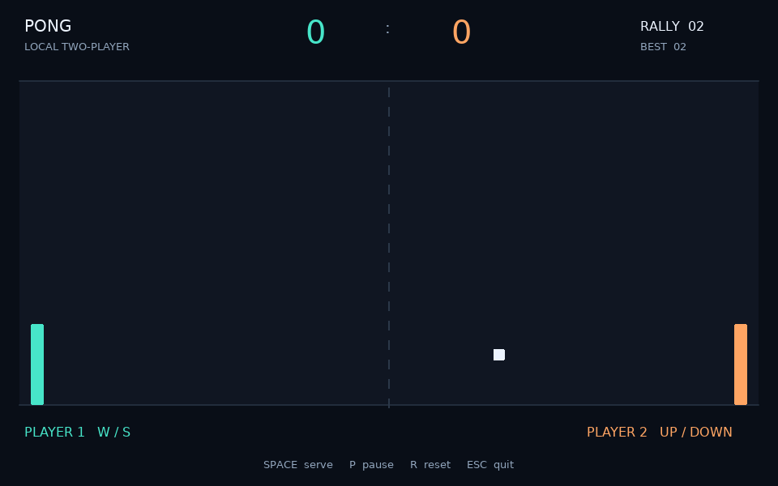
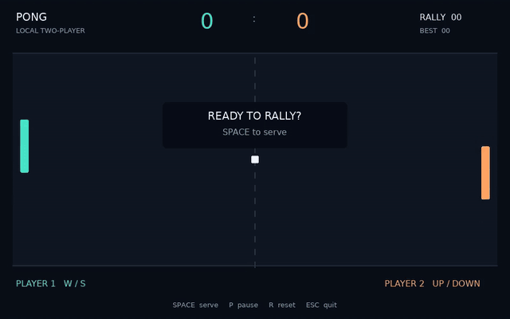

# Pong in LÖVE

**Student:** Rahaf Haj Ali  
**Student ID:** 12217878  
**Course:** Artificial Intelligence and Games — الذكاء الاصطناعي والألعاب  
**Section:** 1

## About the game

A local two-player Pong game written in Lua with the LÖVE framework. Two players move rectangular paddles to return a square ball. The ball bounces off the top and bottom walls and both paddles. Missing the ball gives the other player a point and returns the ball to the center for the next serve. Movement uses delta time, and rectangle collisions use AABB overlap checks. A dark court, color-coded paddles and a live rally counter make the game easy to follow.

## Run

1. Install [LÖVE](https://love2d.org/).
2. Open a terminal in the `pong-love2d` folder, where `main.lua` is located.
3. Run:

```sh
love .
```

On Windows, you can also drag the project folder onto the LÖVE application shortcut. If the `love` command is not recognized, add the LÖVE installation folder to PATH or use the shortcut method.

## Controls

| Action | Key |
| --- | --- |
| Left paddle up / down | W / S |
| Right paddle up / down | Up / Down arrows |
| Serve from the center | Space |
| Pause / resume | P |
| Reset the match and counters | R |
| Quit | Escape |

Paddles stay between the top and bottom court boundaries. Holding opposite movement keys together cancels movement for that paddle.

## My own change

I added a **rally hit counter**: each paddle collision increases `RALLY`, and `BEST` records the longest rally during the current match. Serving starts a new rally, while R clears the entire match. I also gave the paddles different colors and added Space-to-serve, scoring, pause and reset controls.

## Screenshot



## Short demo

[Watch the MP4 demo](demo/pong-demo.mp4)



The demo records the actual LÖVE runtime using scripted keyboard input to demonstrate both paddles, serving, rallies, pausing and scoring. Normal gameplay is controlled by two people on the keyboard.

## The three main callbacks

- `love.load()` runs once and creates the initial game state, window and fonts.
- `love.update(dt)` runs every frame. It reads held keys with `love.keyboard.isDown` and advances the game using elapsed time.
- `love.draw()` runs every frame and draws the current state. It does not change positions or scores.

`love.keypressed(key)` handles one-time actions such as serve, pause and reset.

## Velocity and delta time

`ball.dx` is horizontal velocity and `ball.dy` is vertical velocity, both in pixels per second. Positive x moves right; positive y moves down. Position changes follow:

```lua
ball.x = ball.x + ball.dx * dt
ball.y = ball.y + ball.dy * dt
```

At 320 pixels/second, the ball moves about 5.33 pixels during a 1/60-second frame and about 10.67 pixels during a 1/30-second frame. Both add up to 320 pixels over one second, before collisions. Without multiplying by `dt`, a faster frame rate would move the ball farther each second.

A wall hit reverses `dy`. A paddle hit reverses `dx` and moves the ball just outside the paddle. The collision check also requires the ball to be travelling toward that paddle. Small simulation steps consume the full `dt` and help prevent the ball from passing through a paddle on a slow frame.

## Files

| File | Purpose |
| --- | --- |
| `main.lua` | LÖVE callbacks, keyboard controls and rendering |
| `pong.lua` | Paddle tables, ball velocity, AABB collisions and scores |
| `conf.lua` | Window and LÖVE settings |
| `tests/test_pong.lua` | Physics and callback checks using plain Lua |
| `screenshots/pong.png` | Screenshot captured from the running game |
| `demo/pong-demo.mp4` | Short runtime recording |
| `demo/pong-demo.gif` | Inline animated preview |

## Tests

With Lua installed, run from the project folder:

```sh
lua tests/test_pong.lua
```

The tests cover delta time at 30, 60 and 144 FPS, paddle boundaries, both wall bounces, both paddle collisions, separation after impact, a fast-ball slow-frame case, scoring, serving, pause, reset and the keyboard callbacks.

## Git history and publishing

The project includes the required first commit:

```text
Part 1: window and paddles
```

That commit contains the working window and keyboard-controlled paddles. The next commit adds the ball, collision handling, personal changes, tests and documentation. The final commit includes the runtime screenshot and demo.

To submit, publish this existing local repository as a **public** GitHub repository named **pong-love2d**. In GitHub Desktop, use **File → Add local repository**, select this folder, choose **Publish repository**, and clear **Keep this code private**. This preserves the existing commits. Submit the public repository URL.

## References

- [Assignment video, Part 1](https://www.youtube.com/watch?v=igQPL0Ali8M)
- [Assignment video, Part 2](https://www.youtube.com/watch?v=0F37c-x2ZFk)
- [LÖVE: love.load](https://love2d.org/wiki/love.load)
- [LÖVE: love.update](https://love2d.org/wiki/love.update)
- [LÖVE: love.draw](https://love2d.org/wiki/love.draw)
- [LÖVE: love.keyboard.isDown](https://love2d.org/wiki/love.keyboard.isDown)

The implementation follows the written assignment requirements. The linked video pages could not be retrieved in the build environment, so this is not a verified line-by-line reproduction of the videos.

## Validation

Tested with LÖVE 11.5 and Lua 5.4. All 15 automated checks passed. The screenshot and the 22-second, 960×600 demo were captured from the running LÖVE game.
